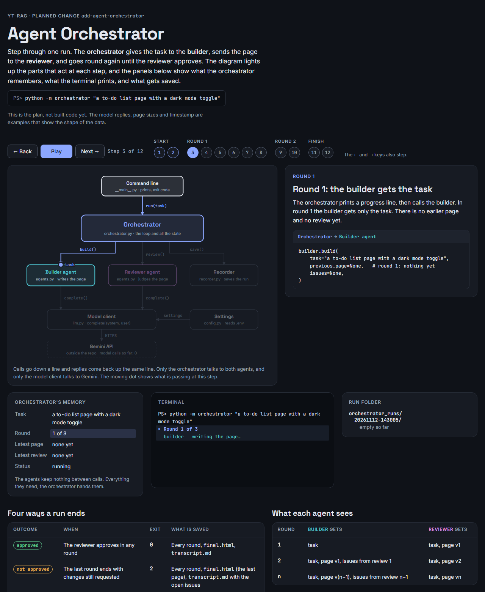
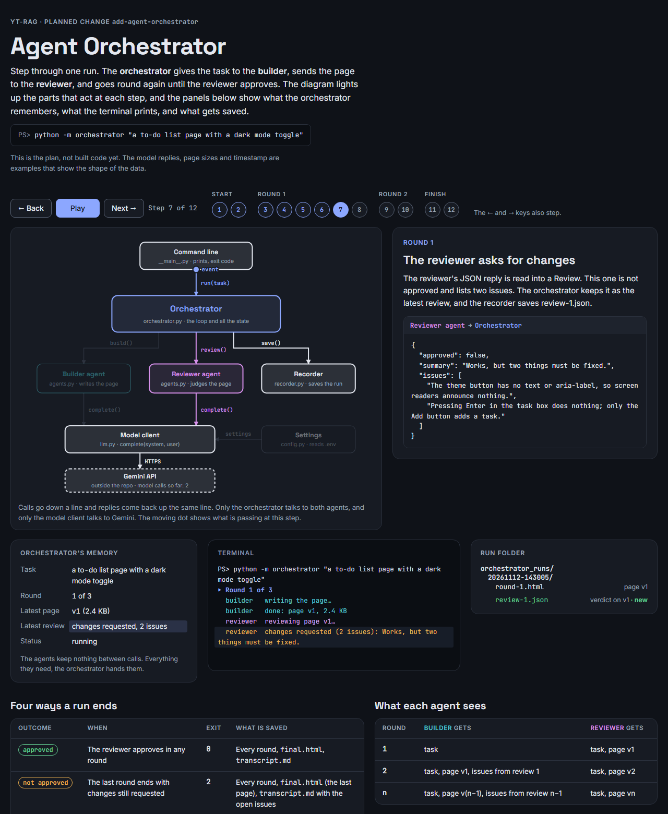
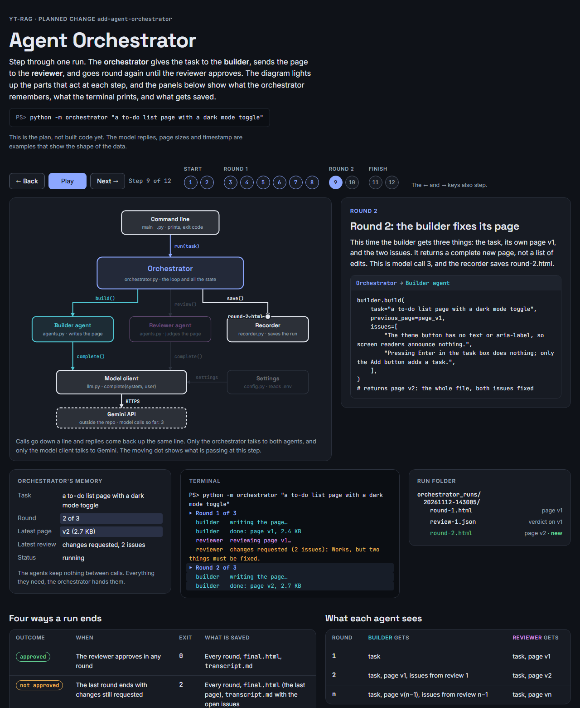
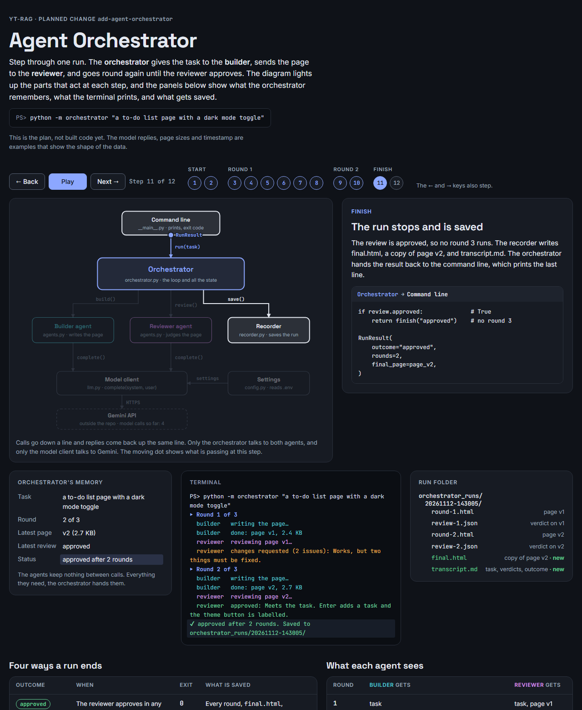

# Agent orchestrator

A small example of a multi-agent system. You describe a web app in plain words. A **back-end agent** writes its API, a **front-end agent** writes the page that calls it, a **reviewer agent** checks both, and an **orchestrator** routes each issue back to the agent that owns it, until the reviewer approves.

It runs on Gemini's free tier and prints every step, so you can follow the flow. The result is a small app you can run: one FastAPI file, `api.py`, that also serves one page, `index.html`.

## The flow

```
                     task (from the command line)
                          │
                          ▼
                 ┌──────────────────┐
                 │   Orchestrator   │  holds: task, api.py, index.html, latest review, round
                 └──────────────────┘
       ① task (+ last api.py │    ▲ ② api.py
          + backend issues)  ▼    │
                 ┌──────────────────┐
                 │  Back-end agent  │  "write / fix api.py"            (round 1, or backend issues)
                 └──────────────────┘
       ③ task + api.py       │    ▲ ④ index.html
         (+ last page        ▼    │
          + frontend issues) ┌──────────────────┐
                 │ Front-end agent  │  "write / fix index.html"        (round 1, frontend issues,
                 └──────────────────┘                                   or api.py changed)
       ⑤ task + api.py       │    ▲ ⑥ verdict {approved, summary,
         + index.html        ▼    │            issues: [{owner, issue}]}
                 ┌──────────────────┐
                 │  Reviewer agent  │  "review both files against the task"
                 └──────────────────┘

        Orchestrator saves round-N/, then decides:
          approved                  → stop, outcome "approved"      (exit 0)
          not approved, rounds left → next round: route issues by owner, back to ①
          not approved, last round  → stop, outcome "not approved"  (exit 2)
          any model error           → stop, outcome "failed"        (exit 1)
```

What each agent receives:

| Round | Back-end agent | Front-end agent | Reviewer |
|---|---|---|---|
| 1 | task | task, api.py | task, api.py, index.html |
| 2 and later | only if it has issues: task, its last api.py, its issues | task, current api.py, its last page, its issues (or a note that api.py changed) | task, current api.py, current index.html |

### How issues are routed

The reviewer tags every issue `backend` (api.py must change) or `frontend` (index.html must change). In the next round, the orchestrator:

1. runs the back-end agent only if there are backend issues, otherwise it keeps `api.py`;
2. runs the front-end agent with its issues, or, when it has none, because `api.py` changed and the page must follow it;
3. sends an issue with no recognized owner to both agents, so nothing is dropped.

So a round that only needs front-end fixes makes 2 model calls instead of 3.

### Who does what

- **The orchestrator decides what happens next.** It is plain Python, not a model. The routing rules and the stop decision are ordinary `if` statements in [orchestrator.py](orchestrator.py).
- **Each agent defines a job.** An agent is a fixed role prompt, one model call, and code that reads the reply ([agents.py](agents.py)).
- **The model does the work.** It writes the code or judges it. All three agents use the same model; only their prompts differ. The model remembers nothing between calls, so every call carries everything it needs.

## Set up

The orchestrator uses the same three settings as the RAG app, read from the environment or from `.env` in the folder you run it from. It doesn't need the Supabase settings.

To use Gemini's free tier, get a key from [Google AI Studio](https://aistudio.google.com) and put this in `.env`:

```
OPENAI_BASE_URL=https://generativelanguage.googleapis.com/v1beta/openai/
OPENAI_API_KEY=your_gemini_api_key_here
OPENAI_CHAT_MODEL=gemini-3.5-flash
```

Any other OpenAI-compatible endpoint works too. Leave `OPENAI_BASE_URL` empty to use OpenAI itself.

To try a different model without editing `.env`, set the variable in your terminal. It overrides `.env` until you remove it or close the terminal. In PowerShell:

```powershell
$env:OPENAI_CHAT_MODEL = "gemini-3.5-flash-lite"
python -m orchestrator "a to-do list app"
Remove-Item Env:OPENAI_CHAT_MODEL   # back to the model in .env
```

In bash, `OPENAI_CHAT_MODEL=gemini-3.5-flash-lite python -m orchestrator "a to-do list app"` sets it for that one command.

## Run it

From the repository root, with the dependencies from `requirements.txt` installed:

```bash
python -m orchestrator "a to-do list app"
python -m orchestrator "a counter app" --max-rounds 1
python -m orchestrator --help
```

| Option | Default | Meaning |
|---|---|---|
| `--max-rounds N` | `3` | Most rounds, from 1 to 10. Each round makes 2 or 3 model calls. |
| `--out-dir PATH` | `orchestrator_runs` | Folder that holds the run folders. |

A run prints one line per step. The agent's name starts each line, so you can always see which agent is working. A "writing..." or "fixing..." line with no "done" after it means that agent is waiting for the model.

```
== Round 1 of 3 ==
  backend   writing api.py...
  backend   done: api.py, 2.9 KB
  frontend  writing index.html...
  frontend  done: index.html, 8.7 KB
  reviewer  reviewing api.py and index.html...
  reviewer  changes requested (1 issue: 1 frontend): The delete buttons have no accessible label.
== Round 2 of 3 ==
  backend   no backend issues, keeping api.py
  frontend  fixing 1 issue in index.html...
  frontend  done: index.html, 8.8 KB
  reviewer  reviewing api.py and index.html...
  reviewer  approved: The API and page together meet the task.
Result: approved after 2 rounds. Run folder: orchestrator_runs/20261112-143005
Run the app:  cd orchestrator_runs/20261112-143005/final
              python -m uvicorn api:app   (then open http://127.0.0.1:8000)
```

If a model call fails, the line names the agent and the error type, then the run stops:

```
  reviewer  reviewing api.py and index.html...
  error     reviewer failed: RateLimitError (HTTP 429)
Result: failed in round 2. Run folder: orchestrator_runs/20261112-143005
```

`RateLimitError` means the free tier's per-minute or per-day limit was reached; some models allow only about 20 calls a day. `InternalServerError (HTTP 503)` means the model is busy. Wait and run again, or try another model for one run as shown above.

## The run folder

Every run gets its own folder, `orchestrator_runs/<YYYYMMDD-HHMMSS>/`. Files are written as soon as each step finishes, so a failed run still keeps its finished work.

| Path | Contents |
|---|---|
| `round-N/api.py` | The back end after round N. When the back-end agent was skipped, a copy of the round before. |
| `round-N/index.html` | The page after round N |
| `round-N/review.json` | `{"approved": ..., "summary": ..., "issues": [{"owner": ..., "text": ...}]}` for round N |
| `final/api.py`, `final/index.html` | The last app. Not written when the run failed. |
| `transcript.md` | The task, which files were written or kept each round, every verdict with its issues and owners, and the outcome |

Every round folder is a complete app, so you can run any of them, not only `final/`. `orchestrator_runs/` is git-ignored.

## Run the generated app

**Read `api.py` and `index.html` first.** They are code written by a model. The orchestrator only saves them; it never runs, imports or serves them.

Then, with the project's virtual environment active (it already has `fastapi` and `uvicorn`):

```bash
cd orchestrator_runs/<run>/final
python -m uvicorn api:app
```

Open http://127.0.0.1:8000. `api.py` serves the page at `/` and its API under `/api/`, so the page calls the API on the same address. The data lives in memory and is gone when you stop the server with Ctrl+C.

## Exit status

| Status | Meaning |
|---|---|
| `0` | The reviewer approved the app. |
| `2` | The last round ended with changes still requested. `final/` holds the last app; the open issues are printed and are in `transcript.md`. |
| `1` | The input was invalid (no task, `--max-rounds` outside 1 to 10, no `OPENAI_API_KEY`), or a model call failed. Invalid input is caught before any model call. |

## Read the code

Read the files in this order:

| File | What it does |
|---|---|
| [`__main__.py`](__main__.py) | Reads the command line, checks the input, creates the three agents and connects them, and turns the outcome into an exit status |
| [`orchestrator.py`](orchestrator.py) | The loop: back end, front end, reviewer, decide. Holds all the state and the routing rules. |
| [`agents.py`](agents.py) | The three agents: their prompts, what they send, and how their replies are read |
| [`llm.py`](llm.py) | The model client, the only code that talks to the model. Error messages keep the error type only, never the provider's text. |
| [`recorder.py`](recorder.py) | Writes the run folder |
| [`config.py`](config.py) | The three `OPENAI_*` settings |

The tests in [`tests/test_orchestrator.py`](../tests/test_orchestrator.py) run offline with a scripted fake model, so they cost nothing:

```bash
pytest tests/test_orchestrator.py
```

## Walkthrough screenshots

Four steps from the interactive walkthrough of one run. They show the **first version** of the flow, where a single builder agent wrote the page and the reviewer checked it. The current version splits that builder into the back-end and front-end agents, as in the diagram at the top. The orchestrator's loop, its memory, the terminal output and the run folder work the same way.

**Step 3: the orchestrator gives the builder the task.** In round 1 the builder gets only the task.



**Step 7: the reviewer asks for changes.** Its JSON verdict lists two issues, and the orchestrator keeps it as the latest review.



**Step 9: the builder fixes its page.** In round 2 the builder gets the task, its own page v1 and the two issues.



**Step 11: the run stops and is saved.** The reviewer approved round 2, so the recorder writes the final files and the transcript, and the result goes back to the command line.



## Ideas for the next version

Each of these changes one part and leaves the rest alone:

- **A model as the orchestrator:** replace the loop with a model that gets "build back end", "build front end" and "review" as tools and chooses which to call.
- **A tester agent:** a fourth agent that starts the app, calls the API and loads the page, and reports what breaks. The reviewer only reads code, so it can miss bugs that only show up when the app runs.
- **A web page for the orchestrator:** pass an `on_event` function that streams each step to a browser instead of printing it.
